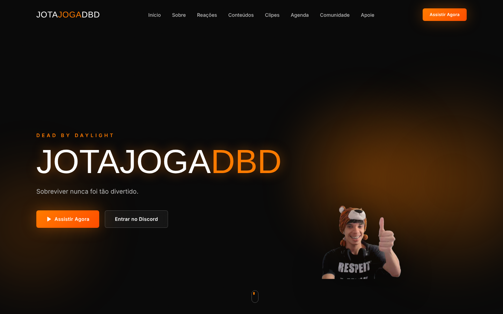
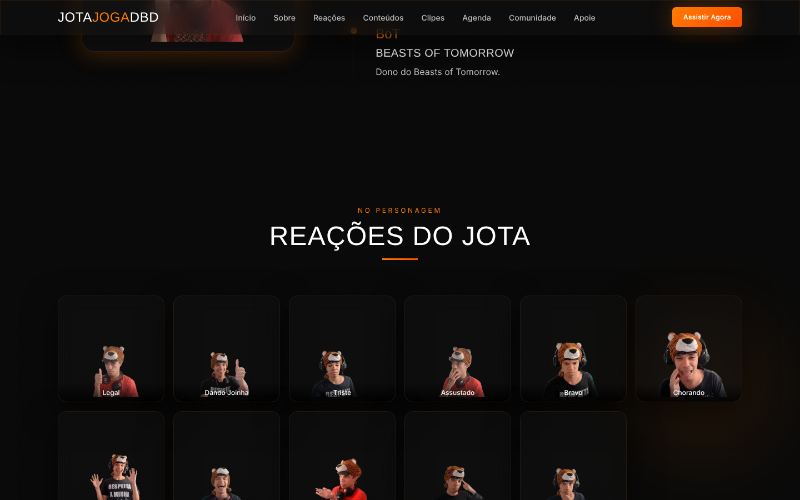

<div align="center">

# JotaJogaDBD — Site Oficial

**Projeto real, entregue a cliente**: landing page institucional para o streamer de Dead by Daylight **JotaJogaDBD**, construída em colaboração com Marina Barbs.

[](#)
[](#)
[](https://github.com/MatheusAnsel/streamer-landing-page/actions/workflows/ci.yml)
[](#)
[](#)

</div>

[Demo ao vivo](https://streamer-landing-page-sigma.vercel.app)

## Telas

| | |
|---|---|
|  |  |
| Seção inicial, com chamadas para assistir à live e entrar no Discord | Galeria de reações, alimentada por `/config` |

---

Construído com Next.js 15 (App Router), e TailwindCSS, com foco em uma arquitetura que o próprio cliente conseguisse manter sem depender de programador para trocar um link ou uma imagem — todo o conteúdo editável foi isolado em `/config` (veja a seção abaixo).


## Rodando localmente

```bash
npm install
npm run dev
```

Abra http://localhost:3000

Outros comandos: `npm run build` (build de produção) e `npm run typecheck`.

## Verificação automática (CI)

O workflow em `.github/workflows/ci.yml` roda a cada push na `main` e em todo pull request: auditoria das
dependências de produção (falha em vulnerabilidade crítica), verificação de tipos (`tsc --noEmit`) e build.
O projeto não tem testes automatizados.

## Onde editar as coisas (a parte mais importante)

**Toda edição do dia a dia acontece na pasta `/config`.** Nada de link ou texto
está "hardcoded" dentro dos componentes — veja `config/README.md` para o guia
completo, mas em resumo:

| Quero mudar... | Arquivo |
|---|---|
| Link da Twitch, YouTube, Discord, Instagram, TikTok, grupo do WhatsApp | `config/socials.ts` |
| Assinatura e PIX/doação via LivePix (seção Apoie) | `config/socials.ts` |
| Nome, tagline, textos de SEO | `config/site.ts` |
| Números de seguidores/horas de live/partidas | `config/site.ts` → `stats` |
| Destaques da seção Sobre | `config/site.ts` → `timeline` |
| Cards da seção Conteúdos | `config/site.ts` → `contentCategories` |
| Clipes do carrossel | `config/site.ts` → `clips` |
| Próximas lives (Agenda) | `config/site.ts` → `schedule` |
| Galeria de Reações | `config/site.ts` → `reactions` |
| Imagens (hero, foto, thumbnails) | arquivos em `/public` |

## Estrutura de pastas

```
/app                  Rotas do Next.js (App Router), layout, SEO (sitemap/robots)
/components
  /ui                 Componentes reutilizáveis (Button, SectionHeading)
  /sections           Uma seção do site por arquivo (Hero, Stats, About...)
/config               TODOS os links e conteúdos editáveis do site
/hooks                Hooks customizados (ex.: contador animado das estatísticas)
/lib                  Funções utilitárias
/public               Imagens e assets estáticos
```

## Seções implementadas

Navbar · Hero · Estatísticas · Sobre · Conteúdos · Clipes (carrossel) · Reações
· Agenda · Comunidade · Apoie · Footer — nessa ordem, seguindo o briefing.

## Stack

- Next.js 15 (App Router, Server Components)
- React 18 + TypeScript
- TailwindCSS (paleta e tipografia customizadas em `tailwind.config.ts`)
- lucide-react (ícones)

## Imagens

As fotos do streamer em `/public/photos` (hero, seção Sobre e galeria de Reações) são
fotos reais enviadas pelo cliente, com o fundo removido. As capas dos cards de Conteúdos
ficam em `/public/content`. Para trocar qualquer imagem, basta substituir o arquivo
mantendo o mesmo nome — nenhum componente precisa ser alterado.

## Créditos

Desenvolvido por **Matheus Ansel** em colaboração com **Marina Barbs**.

- GitHub: [@MatheusAnsel](https://github.com/MatheusAnsel)
- LinkedIn: [linkedin.com/in/matheusansel](https://linkedin.com/in/matheusansel)

